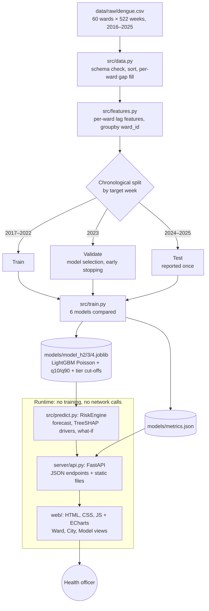
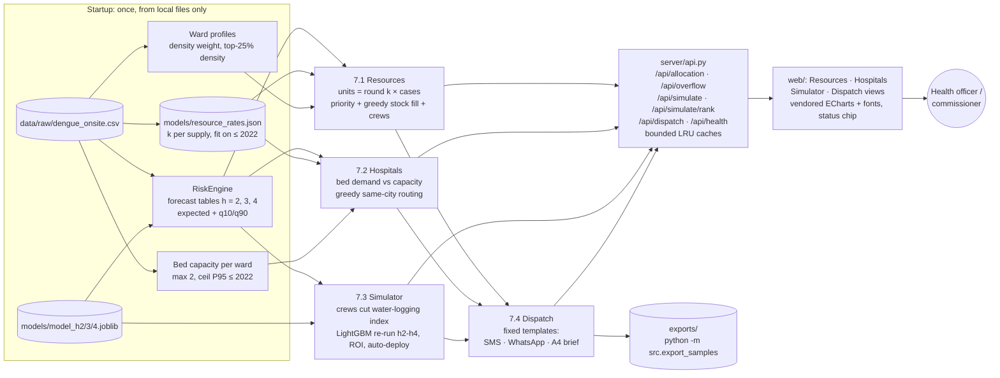

# Architecture: Dengue Watch

Ward-level dengue early warning for Dhaka North, Dhaka South, Chattogram, Gazipur and Narayanganj
(60 wards). The system predicts weekly cases **2, 3 and 4 weeks ahead** from lagged weather and
ward vulnerability, and turns each prediction into a **Low / Medium / High / Critical** risk tier.

## 1. System data flow

- **Offline (once):** `python -m src.train` builds the features, compares the models, trains the
  deployed models and writes the `.joblib` and `metrics.json` files. This takes about 3 minutes on
  a laptop CPU.
- **Online (every request):** `python -m server` loads the saved models once. The browser calls the
  JSON API: `/api/meta`, `/api/ward`, `/api/city`, `/api/heatmap`, `/api/model` and `/api/health`,
  plus the Phase 2 endpoints in section 7.
- An alternative Streamlit UI (`app/`) uses the same `RiskEngine`.

## 2. Forecast framing and lag features

At **issue week *t*** an officer knows the weather up to *t*. We predict `dengue_cases` at
**week *t + h***, with one direct model per horizon *h* ∈ {2, 3, 4}. Every feature uses only rows
≤ *t*, computed with `groupby("ward_id").shift(k)`, so data never leaks between wards or from the
future. `tests/test_features.py` verifies exact lag values, the absence of cross-ward leakage, and
that the label really is *t + h*.

| Group | Features (40 in total) | Why |
|---|---|---|
| Rain lags | rain 0–8 weeks before *t* | Breeding clock: eggs need 7–14 days to become adults, then incubation |
| Rain windows | 2-, 4- and 8-week sums, heavy-rain-week count | Accumulated standing water |
| Temperature and humidity | lags 0–4 weeks, 4- and 8-week means, diurnal range | Mosquito development and survival |
| Ward vulnerability | density, water-logging, sanitation | Same rain, different outcome per ward |
| Interactions | rain × water-logging, rain × (1 − sanitation) | Hyper-local hotspots |
| Season | sin/cos of the target week | Monsoon calendar |

**Evidence from the data:**
- Cases correlate most strongly with rainfall at a **3-week lag (r = 0.75)**, with humidity at
  2 weeks and with temperature at about 8 weeks.
- Water-logging risk correlates 0.82 with a ward's average cases.
- At *h* = 3 the top feature is `rain_sum_2w`, which is rain 3–4 weeks before the target week.

## 3. Chronological validation split

| Set | Target weeks | Used for |
|---|---|---|
| Train | 2017–2022 (2016 is used only as lag history) | Fitting |
| Validation | 2023 | Model comparison, early stopping |
| Test | 2024–2025 | Final evaluation, looked at once |

Rows are **never shuffled**. An expanding-window **backtest** also retrains on all years before *Y*
and predicts *Y* for every *Y* from 2019 to 2025; the yearly error stays between 0.9 and 1.7 cases.
**Risk-tier cut-offs** come from training data only (the 60th, 80th and 95th percentiles of weekly
cases): **Low < 1 ≤ Medium < 5 ≤ High < 13 ≤ Critical**.

## 4. Model selection rationale

On the validation season (2023), 3 weeks ahead:

| Model | MAE | RMSE | High-risk recall |
|---|---|---|---|
| Baseline: copy this week | 2.69 | 5.25 | 0.69 |
| Baseline: same week last year | 2.12 | 4.20 | 0.85 |
| Poisson regression (statistical) | 1.39 | 2.93 | 0.85 |
| Random forest | 1.22 | 2.41 | 0.90 |
| XGBoost (Poisson) | 1.16 | 2.41 | 0.89 |
| **LightGBM (Poisson), deployed** | **1.15** | **2.37** | **0.90** |

**Why LightGBM with a Poisson objective:**
- The target is a non-negative count and 58% of weeks are zero, which Poisson loss handles naturally.
- It captures non-linear rain × vulnerability effects.
- It is the best or tied-best model on validation.
- It is fast to train.
- It gives exact TreeSHAP explanations for free (`pred_contrib=True`).

Separate quantile models (α = 0.1 and 0.9) give an 80% likely range. A deliberate simplification:
adding past case counts changed test error by less than 0.01, so the deployed model uses **weather,
ward and season only**. It keeps working when hospital reports are delayed.

**Held-out test (2024–2025):**

| Horizon | MAE | RMSE | Exact tier accuracy | High-risk recall | 80% range coverage |
|---|---|---|---|---|---|
| 2 weeks | 0.995 | 1.99 | 79.8% | 87% | 77% |
| 3 weeks | 1.019 | 2.01 | 78.9% | 84% | 73% |
| 4 weeks | 1.161 | 2.28 | 77.2% | 86% | 72% |

At 3 weeks, this is 1.7× more accurate than "same week last year".

**As a yes/no outbreak alert (≥ 4 cases in a ward-week).** The same model gives the alert by scoring
P(cases ≥ 4) from its Poisson forecast and flagging a ward-week when that is ≥ 0.5. No separate
classifier is needed. Results on the 2024–2025 test, all 60 wards:

| Horizon | Accuracy | Recall (outbreaks caught) | Precision | F1 | ROC-AUC |
|---|---|---|---|---|---|
| 2 weeks | 93.3% | 94.8% | 81.0% | 0.874 | 0.979 |
| 4 weeks | 93.2% | 93.8% | 81.1% | 0.870 | 0.974 |

**What did not help** (`python -m src.experiments`, test error at *h* = 3; the deployed model is 1.019):

| Alternative | Test MAE |
|---|---|
| Optuna tuning | 1.019 |
| LightGBM + XGBoost ensemble | 1.019 |
| All-model ensemble | 1.052 |
| MLP neural net | 1.166 |
| One model per city | 1.033 |
| One model per ward | 1.093 |
| Season / off-season models | 1.012 |
| 24 extra features (longer lags, smoothed weather, city-wide weather) | 1.030 |

Every gain is within about 0.01, which is noise. The all-model ensemble looked best on validation
but was worse on test, because it overfits a single season. If weekly counts are Poisson around the
true mean, even a **perfect model would average about 0.81 cases off**, so we are close to the
achievable limit. One global model also forecasts new wards without retraining.

## 5. Compute and cost efficiency

- **Train once, serve many.** The models are serialised with `joblib` (about 1.5 MB per horizon).
  The server never retrains.
- **Caching.**
  - The `RiskEngine` and all forecast tables (60 wards × every week × 3 horizons) are built once
    at startup.
  - API responses are computed from in-memory tables and kept in bounded LRU caches (about 45 MB
    when all are full, see 7.5).
  - The browser keeps a small response cache. The app's own JS/CSS/HTML are revalidated on every
    load (`Cache-Control: no-cache` + ETag), so a deploy is never hidden behind a stale module.
- **Latency.**
  - Cold start: about 1.5 s.
  - Warm API calls: 1–3 ms.
  - A new what-if scenario rebuilds features for **one ward only**: about 20 ms.
- **Request minimisation in the UI.** Slider changes are debounced (about 150 ms), stale requests
  are cancelled with `AbortController`, and the ECharts library is stored locally (no CDN calls).
- **LLM and API cost: zero.** No LLM, no external weather API and no paid service at runtime, so
  there are no tokens to budget and no rate limits. Statistical and ML models only, so the system
  cannot hallucinate numbers.
- **Light install.** The runtime needs 7 packages (pytest and httpx, also in `requirements.txt`, run the tests). A fresh `pip install -r requirements.txt` takes
  under a minute with a warm cache.

## 6. Resilience

- **Input checking.** On load, the system validates the schema and rejects duplicate ward-weeks. It
  fills missing weather **within a ward only**.
- **API errors.** Bad parameters (an unknown ward, an invalid date) return a clear 400 message.
  Dates are clamped to the valid range, and no stack trace ever reaches the UI.
- **Frontend.** If a request fails, the frontend shows an inline message with a **Retry** button.
  Future weeks show "not yet recorded" instead of failing.
- **Safe outputs.** Predictions are clipped to zero or above, and the likely range always contains
  the point forecast.
- **Planned live weather feed (final round).** Fetch once per day per city, cache to disk with a
  timestamp, retry with exponential back-off, and fall back to the last cached value, so the
  dashboard never breaks when the network does.

## 7. Phase 2: operational command system

Phase 2 adds operations modules on top of the unchanged forecaster. The onsite dataset
(`data/raw/dengue_onsite.csv`) has the same 31,320 rows and identical base columns as the Phase 1
file, plus `saline_bags_needed`, `diagnostic_kits_needed` and `hospital_beds_required`.
`tests/test_data.py` checks that the base columns are identical. So the features, models and
forecasts do not change, and no retraining is needed. `config.RAW_CSV` uses the onsite file when it
exists and falls back to `dengue.csv`.

**Overview.** Every module is deterministic Python over the forecast tables built at startup. Nothing
on this path trains a model, calls an external API or LLM, or needs the internet.

Each module answers one question, and each one's output is the next one's input:
- **7.1 Resources:** who gets the scarce supplies and crews this week?
- **7.2 Hospitals:** where do the beds run out, and where can the overflow go?
- **7.3 Simulator:** where would crews prevent the most cases?
- **7.4 Dispatch:** what do we tell each ward?
- **7.5 Offline resilience:** all of the above keeps working with the network unplugged.

The assumptions and limits of every module are collected in 7.6.

### 7.1 Constrained resource allocation (`src/resources.py`, `GET /api/allocation`)

**Supply rates are learned, not hardcoded.** In the data, each supply is almost exactly a per-case
ratio. One rate `k` per supply is fitted by least squares through the origin
(`units = k × cases`) on **training years only** (≤ 2022), then scored on 2024–25. The rates are
cached in `models/resource_rates.json`; refit them with `python -m src.resources`.

| Supply | k per case | R² (test) |
|---|---|---|
| Saline bags | 2.384 | 0.9996 |
| Diagnostic kits | 1.158 | 0.998 |
| Hospital beds | 0.295 | 0.973 |

**Units.** Requirement = `round(k × expected cases)` for the forecast week. A "safety" figure uses
the q90 forecast (upper end of the 80% range).

**Priority.** Wards are sorted by risk tier (Critical > High > Medium > Low). Within a tier they
are sorted by `expected_cases × density_weight`, where
`density_weight = ward density / city median density`, clipped to 0.5–2.0. Ties break by ward ID,
so the plan is deterministic. Each ward's priority rank is shown in the UI.

**Allocation, per supply.** Available stock = `floor(stock% × total required in scope)`, where the
scope is one city or all 60 wards. Stock is then handed out greedily:
1. Critical wards are filled completely, in priority order.
2. With the optional floor: every other ward is raised to 20% of its need.
3. The remaining stock goes down the priority list.

No ward gets more than it needs, and total allocated = min(available, required), so nothing is
wasted. Tests check this conservation property at several stock levels.

**Flags.**
- **CRITICAL DEFICIT:** a High or Critical ward gets less than 100% of any supply.
- **WARNING:** a lower-tier ward gets less than 100% of any supply.

**Spraying crews.**
- Crews needed: Low 0, Medium 1, High 2, Critical 3.
- Wards in the top 25% of density in their city get +1. This applies only to wards that need
  spraying at all, i.e. Medium and above.
- The "Total spraying crews" pool is assigned down the same priority list.

**Cost.** One request is a pandas lookup of the precomputed forecast table plus a greedy pass over
at most 60 wards. It takes about 30 ms cold, and results are cached per (scope, week, horizon,
stock, crews, floor).

### 7.2 Hospital surge and overflow routing (`src/hospitals.py`, `GET /api/overflow`)

**Capacity is an assumption, stated in the UI.** The dataset has no bed-capacity column. Each ward's
baseline capacity is `max(2, ceil(P95 of its weekly hospital_beds_required in training years ≤ 2022))`.
That is the number of beds the ward needed in a bad-but-normal week. Baselines range from 2 to 6
beds per ward (224 in total). A **capacity scale** slider (50–200%) multiplies the baseline:
`capacity = max(1, round_half_up(baseline × scale))`.

**Demand** for the forecast week is `round(k_beds × cases)`, using the bed rate learned in 7.1.
- *Expected* uses the point forecast. It equals the Resources view's beds required, and a test
  checks this.
- *Surge* uses the upper end of the 80% range (q90), the safer figure for bed planning. The UI
  defaults to surge; the API defaults to expected.

**Per ward:** `deficit = max(demand − capacity, 0)` and `headroom = max(capacity − demand, 0)`.

**Routing, per city. Patients are never routed across cities.** The steps repeat until there are
no deficits or no usable headroom left:
1. The sender is the ward with the largest remaining deficit.
2. The receiver is the non-Critical ward with the most headroom, then the lowest utilisation.
   Critical wards keep their spare beds for their own surge.
3. Move `min(deficit, headroom)` patients from sender to receiver.

Ties break by ward ID, so the plan is deterministic. There are no ward coordinates, so routing uses
headroom and burden, not distance. A real deployment would add travel time as a tie-break.

**Output.**
- A transfer list (from, to, patients).
- Per ward: sent, received, load after routing, net deficit after routing.
- Per city: demand, capacity, utilisation, overflow before routing, patients transferred,
  **unresolved overflow** and **remaining headroom** (including headroom held by Critical wards).

**Invariants tested in `tests/test_hospitals.py`:**
- Every transfer stays within one city.
- Patients sent = patients received, both per city and overall; total load after routing = total
  demand.
- A ward only sends its overflow and only receives into free beds.
- Critical wards never receive.
- `overflow_before = transferred + unresolved` and `headroom_before = transferred + remaining`.
- Greedy is exhaustive: it stops only when deficits or receivable headroom run out.

**Example, demo week** (data up to 2025-07-07, h = 3, surge, 100% capacity): demand is 232 beds
against 224 (104%). 10 beds are over capacity in 9 wards. Only 2 can be routed (both in
Chattogram). 8 stay unresolved in Dhaka North and Dhaka South, which have no free non-Critical beds
left. At 75% capacity with expected demand, all 3 overflow beds are routed.

**Cost.** One request is a lookup plus a greedy pass over at most 20 wards per city. It takes about
20 ms, and results are cached per (city, week, horizon, capacity, basis).

### 7.3 What-if vector control simulator (`src/simulator.py`, `GET/POST /api/simulate`, `GET /api/simulate/rank`)

**Mechanism.** Larviciding and fogging remove breeding sites. The simulator models a crew as a cut
in the ward's `water_logging_risk_index`:
`reduction = min(50%, 1 − (1 − e)^crews)`, with e = 10% per crew by default (adjustable 5–20%).
At 10%, 1 crew cuts the index by 10%, 3 crews by 27%, and the 50% cap is reached at 7 crews.

**Model-driven counterfactual, not a fixed percentage.** The index enters the deployed model in two
features: the index itself and `rain_sum_4w × index`. Crews are deployed in the issue week, and the
LightGBM point, q10 and q90 models are re-run for h = 2, 3 and 4, so the effect lands in the
2-to-4-week window. `RiskEngine.what_if_frame(..., waterlog_pct=)` rebuilds one ward's features from
modified raw rows. Because both features are linear in the index, the simulator instead scales those
two columns directly. Tests check that this matches the full rebuild exactly (difference 0.0), and it
lets one batched model run cover all 60 wards × 3 horizons × every crew level.

**Monotone guard.** Tree models are step functions and have no monotone constraint on this feature.
On 2024–25 test weeks, 24–39% of ward-weeks show a small *increase* (up to about 1 case) at some
lower index. The scenario for *c* crews is therefore the lowest prediction over 0..*c* crews (a team
can always do less). More crews never raise a forecast, and 0 crews equals the baseline forecast
exactly. Tests check both.

**Size of the effect (measured, 2024–25 test weeks, all wards).** A 27% cut in the index (3 crews)
lowers forecast cases by 12–13% on average. The 50% cap lowers them by 22–24%. The effect is larger
in rainy, flood-prone, high-risk wards, where rain × water-logging drives the forecast. For example,
2 crews in DSCC Ward 06 in the demo week take its forecast from 47.2 to 37.9 cases over 2–4 weeks.

**Impact per ward and horizon.** Baseline vs scenario cases (with the 80% range and tier), beds and
saline as `round(k × cases)` using the learned rates from 7.1, and prevented = baseline − scenario.
Beds summed over the three forecast weeks are reported as *bed-weeks*.
**ROI = cases prevented over h2 + h3 + h4 ÷ crews.**

**Ranking and auto-deploy.**
- `/api/simulate/rank` ranks every ward in scope by **1-crew ROI**. It also shows the best ROI at any
  crew count (some wards need 2 crews before the tree model's forecast moves) and the cases
  prevented at the cap.
- `?auto=N` deploys N crews by **greedy marginal ROI**. Each step gives crews to the ward and
  increment with the most extra cases prevented per crew. It compares every increment (+1, +2, …),
  so it can see past plateaus where one more crew alone changes nothing. It stops early if no ward
  can prevent more cases, and reports the spare crews. Tests check that it beats two naive plans
  (1 crew to each top-N ward; all N to the top ward).

**Demo week** (data up to 2025-07-07, effect 10%): auto-deploying 10 crews places them in 6 wards
and prevents 41.1 forecast cases over 2–4 weeks (14 bed-weeks, 95 saline bags), ROI 4.1 cases per
crew. With 20 crews: 72.2 cases, 22 bed-weeks and 170 saline bags, ROI 3.6. The ROI falls as the best
wards are used up.

**Cost.** One batched run (60 wards × 3 horizons × up to 15 crew levels × 3 models) takes about
70–90 ms. It is cached per (issue week, effect), so ranking, manual plans and auto-deploy are then
lookups of about 3 ms.

**Limits (stated in the UI).** This is the model's counterfactual, not a field trial. The dataset
has no intervention history, so the per-crew effect `e` is an assumption the user can adjust.

### 7.4 Multi-channel dispatch (`src/dispatch.py`, `GET /api/dispatch`, `python -m src.export_samples`)

**Numbers are never recomputed.** A notice is rendered from the same cached payloads that serve
`/api/allocation`, `/api/overflow` and `/api/simulate`. Allocation uses the ward's city as the stock
pool (`pool=city`) or all 60 wards (`pool=all`, the Resources default). Overflow always uses the
ward's own city. Tests check every ward's supplies, flags, crews, bed demand/capacity and transfers
against those endpoints.

**Deterministic templates, no LLM, no network.** Plain Python f-strings and rule-based actions.
Actions are ranked most urgent first: unplaced bed patients, critical resupply, outgoing transfers,
the tier response, crew shortfall, incoming transfers, then routine top-ups. The same input gives the
same text. The only clock-dependent line is the brief's "Generated" stamp, and callers can fix it.

**Written for non-technical readers.** The notices go to councillors and ward health officers, so the
human-facing text follows fixed writing rules. The JSON context keeps every engine number unchanged.
- Cases are whole numbers, with the forecast range in words: "about 9 cases (likely 5 to 14)",
  "fewer than 1 case", "up to 3". No q10/q90, issue week, priority rank or other internal terms.
- Supplies are shown as need / getting / short. The official flags `CRITICAL DEFICIT` and `WARNING`
  stay, but each is followed by one sentence on what it means and one on why the ward is short,
  e.g. "Stock this week covers 60% of what all 60 wards need; it went first to 33 wards with more
  risk or crowding." (33 = the ward's priority rank - 1.)
- Two kinds of bed, always labelled, so two bed numbers are never shown side by side unexplained.
  **Extra (surge) beds** are the task-1 bed supply (k x cases, shown as need / getting like saline
  and kits). **Regular beds** are a ward's usual capacity from overflow routing (task 2).
- One bed story per ward: patients who may need a bed (in a bad week when beds are planned on the
  upper forecast) vs the ward's regular beds, transfers in/out by ward name, and whether the other
  wards of the city have free beds, e.g. "Up to 4 patients may need a bed in a bad week, which fills
  all 4 regular beds; other Dhaka North wards have none free, so the ward needs extra beds."
- At most 3 actions, each with a verb, an amount and a deadline, e.g. "Request 21 saline bags, 10
  test kits and 3 extra beds from the regional store by 21 Jul". WhatsApp shows the same actions
  with their amounts, without the deadline, which is in its section title. Deadline = the Monday
  before the forecast week, but never sooner than 3 days after the data date (`dispatch.deadline`).
  The one exception is the door-to-door check for breeding sites, which is cheap and urgent, so it
  says "Start ... this week" instead of a deadline.
- The footer and method page describe the model correctly: "Forecast from weather and ward
  conditions, using a model trained on 2017–2023 case records." Case counts are what the model was
  trained on, never an input (`USE_CASE_HISTORY = False`, see section 4).
- Every ward and city context carries `summary` (the "In short" text), `reasons`, `bed_story`,
  `deadline` and actions as `{key, text, sms, chat}`, so the UI shows exactly what was sent.

**Channels.**
- **SMS.** GSM-7 only: any other character is transliterated (`–` to `-`, `→` to `->`), so a message
  never silently switches to UCS-2 at 70 characters per segment. Length is counted the way a phone
  counts it: 160 septets for one segment, 153 per segment when concatenated, and extension
  characters (`^ { } [ ] ~ \ |` and the euro sign) take 2. The target is **1 segment (160)**:
  ward, cases and range, the biggest shortage, and one action with a deadline, signed
  "-Dengue Watch". Wards with a supply deficit open with their flag ("CRITICAL: DNCC Ward 01
  dengue, about 9 cases wk of 28 Jul (up to 14). Need 21 saline, 10 kits, 3 beds, none allocated
  yet. Resupply by 21 Jul. -Dengue Watch", or "WARNING: ..."); other wards open with "Dengue
  alert". Variants are tried in a fixed order: shorter wording first ("3 extra beds" to "3 beds"),
  then without the signature, and only then with fewer facts. A second segment (306 in all) is used
  only for an extra critical fact (a bed transfer, a patient with no bed, or no crew for a Critical
  ward). The flag's meaning and reason are in WhatsApp and the brief. Tests check that all 60
  wards fit 2 segments on four weeks at 30% and 100% stock with 50% bed capacity, and that at least
  80% fit 1 segment at default settings (100% at the API defaults, 58 of 60 in the UI scenario).
  The UI recounts live while the user edits.
- **WhatsApp.** A scannable chat message of about 15 lines: a status dot (red critical, orange
  warning, green ok), then *What to expect*, *Supplies: need / getting* (with flag, meaning and
  reason), *Hospital beds*, *Spraying crews* (plus the simulated impact), *Please do by <date>* with
  up to 3 numbered actions, and a sign-off with the forecast and data dates. No number is repeated.
- **Brief.** Self-contained A4 HTML with inline CSS, system fonts and no external URL (a test checks
  this). Page 1 is for decision makers: title and week, a highlighted "In short", four big figures
  (expected cases, lowest supply coverage, beds, crews), a Need / Getting / Short table, the flag
  with its reason, the bed story, a tick-box "What to do" list, Prepared by / Approved by / Date
  lines and a one-line footer. City briefs add the 8 most urgent wards (sorted by shortages, beds,
  crews, then risk) and the transfers as "Ward A → Ward B: 2 patients". An optional page 2, "How
  these numbers were made", explains the forecast, stock rule, bed-capacity assumption, crew
  assumption and limits in plain words. It is on by default for city briefs and off for ward
  briefs (`method=1|0`, the "Include method page" toggle in the UI). Rows never split across pages;
  colour is used only for status, so it prints in grayscale. A ward brief fits on one page.

**Alerts.** A ward with any supply below 100% always gets its flag (`CRITICAL DEFICIT` for
High/Critical tier, else `WARNING`) with meaning and reason in WhatsApp and the brief; its SMS
starts with `CRITICAL:` or `WARNING:` and names the shortage. A ward still over bed capacity after routing gets a `BED OVERFLOW` alert, and
every channel says how many patients may have no bed.

**Crew impact (optional).** `plan=allocation` runs the simulator counterfactual for exactly the crews
Resources assigned. `plan=WARD:n,...` uses a Simulator plan. With no plan, the impact section is
left out.

**API.** `GET /api/dispatch?scope=ward|city&id=&date=&h=&stock_pct=&crews=&floor=&capacity_pct=&basis=&pool=&plan=&effect=&method=0|1&format=sms|whatsapp|brief|json`.
Every parameter is validated (400 with one sentence) and dates are clamped. Responses are cached per
parameter set, take about 20–90 ms cold and are served as text/plain, text/html or JSON.

**Exports.** `python -m src.export_samples` builds the demo scenario (issue 2025-07-07, h = 3, 60%
stock, 40 crews, surge beds, 100% capacity, crew impact of the allocated crews). For each city it
writes the top 3 priority wards plus the first ward with a supply deficit, and a city summary:
`sms/*.txt`, `whatsapp/*.txt`, `briefs/*.html`, plus `allocation_plan.csv` (all 60 wards) and
`overflow_routes.csv`. City briefs include the method page and ward briefs do not. File names
keep only letters, digits, `-` and `_`, so they are safe on Windows.

**Header nav.** With seven views the tabs no longer fit beside the logo below about 1,000 px. The
logo never wraps; when the tabs overflow, the strip scrolls sideways with an edge fade on the side
that hides more tabs, and the active tab is scrolled into view (`fitNav` in `web/js/app.js`). At
full width it looks as before.

### 7.5 Offline resilience and deterministic fallback

**Nothing at runtime needs the internet.** Forecasting, allocation, routing, simulation and dispatch
read only local files (data CSV, `models/*.joblib`, `models/resource_rates.json`) and run in-process.
There is no LLM, external API, CDN, web-font service or analytics. An audit of `web/`, `server/` and
`src/` found one runtime network dependency, the Google Fonts stylesheet in `index.html`. It is gone:
the Geist and Geist Mono variable fonts (SIL OFL 1.1, licence included) are vendored in
`web/vendor/fonts/` next to `web/vendor/echarts.min.js` and loaded with `@font-face` and
`font-display: swap`. If they ever fail, the system font stacks take over and the layout does not
change. The only other runtime request in the codebase is the `python -m server` launcher's
readiness ping to its own `127.0.0.1`.

**`GET /api/health`** stays a plain 200 for uptime monitors (UptimeRobot pings `/` or this
endpoint) and now reports readiness:
- `offline_ready: true` when every component loaded from local files: `models` (all three
  horizons), `data` (60 wards), `forecast_tables`, `supply_rates`, `bed_capacity`, `web_assets`
  (index, styles, app.js, ECharts, both fonts) and `dispatch_templates`;
- `components` (one flag each), `data_file`, `assets` and `versions` (Python, numpy, pandas,
  scikit-learn, lightgbm, fastapi, uvicorn).

**Status chip.** The header shows a small chip (`web/js/net.js`). It combines `navigator.onLine`
with a `/api/health` ping: every 30 s, on `online`/`offline` events, and when the tab becomes
visible again. Its states:
- **Offline-ready** (green dot) when the server answers with `offline_ready`;
- the same label with a hollow dot when the browser has no internet but the server is reachable
  (a local server keeps working fully);
- **Degraded** (amber), listing what did not load;
- **Server unreachable** (red).

Below 1,280 px only the dot shows, so the chip never crowds the nav; the label stays in the tooltip
and the accessible name.

**Kill-switch test.** `tests/test_offline.py` simulates Wi-Fi off. It patches
`socket.socket.connect`, `connect_ex` and `socket.getaddrinfo` to refuse any host that is not this
machine, and records every attempt so that a swallowed error still fails the test. Under the block
it rebuilds the server state from scratch and clears every response cache, then checks:
- `/api/health` reports `offline_ready`;
- meta, ward, city and model all answer, as do allocation (two scarcity settings), overflow,
  simulate (GET plan, GET auto-deploy and POST) and simulate/rank;
- dispatch answers as SMS, WhatsApp, brief and JSON, for both a ward and a city;
- every HTML/JS/CSS/SVG/font file under `web/` is served byte for byte.

Static guards check that no UI source references an external URL or `@import`, that the vendored
ECharts makes no requests, and that no module in `src/` or `server/api.py` imports a network client.
A headless-Chrome check over all 7 views × 7 widths × light/dark recorded **zero** non-local
requests.

**Caching that never serves stale code.** The app's own files (`index.html`, `styles.css`, `js/*`)
change with every deploy and are ES modules that import each other. A browser that heuristically
cached one module could mix old and new code until a hard refresh. They are now served with
`Cache-Control: no-cache` plus `ETag`/`Last-Modified`, so the browser revalidates on every load and
gets a cheap `304` when nothing changed. Vendored files (`vendor/`) only change when the vendored
version is bumped and stay cacheable (`public, max-age=604800`). Fonts are served as `font/woff2`.
Tests check the headers and the `304` revalidation.

**Memory (Render free tier: 512 MB).** Every response cache in `server/api.py` is a bounded LRU,
sized in one table (`CACHE`), and a test checks that none is unbounded or larger than 128 entries.
Measured retained size per entry (tracemalloc):

| Cache | Entry size | Max entries | Full |
|---|---|---|---|
| ward | 40 KB | 128 | 5 MB |
| city | 9 KB | 128 | 1 MB |
| heatmap | 106 KB | 64 | 7 MB |
| allocation | 124 KB | 64 | 8 MB |
| overflow | 74 KB | 64 | 5 MB |
| simulator curves (with the all-ward ranking) | 386 KB | 16 | 6 MB |
| simulate | 87 KB | 64 | 6 MB |
| rank (per city) | 19 KB | 64 | 1 MB |
| dispatch | 79 KB | 64 | 5 MB |

All caches full add at most about 45 MB (the previous sizes allowed about 145 MB). Every entry
except the simulator curves (about 0.5 s) is recomputed in milliseconds.

Peak memory was measured with every endpoint warmed until every cache was full, on Windows,
in-process:
- all 5 cities and "all";
- 24 issue weeks across 2024–25 and all 3 horizons;
- allocation at 30/60/100% stock;
- overflow at 50/100/200% capacity, both demand bases;
- simulator rank for all scopes at effects of 5/10/20%, with auto-deploy of 10 and 40 crews;
- dispatch city briefs for every city and week, and SMS/WhatsApp/brief for all 60 wards.

The results:
- The working-set peak is **307 MB**, reached while the forecast tables are built at startup, and
  warming does not raise it.
- After warming, the working set settles at about 230 MB.
- Private memory grows by 32 MB with all caches full, down from 92 MB with the previous cache sizes.

On Render the app was observed at about 330 MB, so the bounded caches keep the worst case at about
375 MB, under the 420 MB target. Re-measure on Linux with the server's VmHWM after deploying.

### 7.6 Assumptions and limitations, by module

| Module | Assumptions | Limitations |
|---|---|---|
| Forecast (unchanged) | Weather, ward conditions and season predict cases 2–4 weeks ahead. Trained on 2017–2023 case records; case counts are not an input. | MAE about 1 case per ward-week (2024–25 test). The 80% range covers about 8 in 10 outcomes, so 1 in 5 weeks falls outside it. |
| 7.1 Resources | Supply need is proportional to cases (k fitted on ≤ 2022, R² ≥ 0.97 on 2024–25). Regional stock is a % of total need in scope. Crew needs per tier (0/1/2/3, +1 for top-25% density) are a planning rule, not data. | The greedy fill is a transparent priority rule, not a global optimum. There are no per-ward stock levels, delivery times or transport costs. Stock is pooled within the chosen scope. |
| 7.2 Hospitals | No capacity column exists: each ward's capacity is assumed to be max(2, ceil(P95 of its weekly bed need, ≤ 2022)), scaled 50–200%. Bed demand = round(k_beds × cases), expected or q90. | There are no coordinates, so routing uses headroom and burden, not distance or travel time. It is one-week static routing: no length of stay, so beds do not carry over between weeks. Critical wards never receive. Routing never crosses cities, even when a neighbour city has room. |
| 7.3 Simulator | A crew cuts the ward's water-logging index by e per crew (default 10%, 5–20%, capped at 50%). The effect flows only through the model's water-logging features. | This is a model counterfactual, not a field trial: the data has no intervention history, so e is an assumption. Tree models are stepwise, so small crew counts can show no change; a monotone guard stops more crews from ever raising a forecast. There are no spill-over effects between wards. |
| 7.4 Dispatch | Fixed English templates over the engines' numbers. The deadline is the Monday before the forecast week. | Nothing is sent: notices are generated for copy, download and print, with no SMS or WhatsApp gateway. The text is English only. The SMS budget assumes GSM-7 (non-GSM characters are transliterated). |
| 7.5 Offline | All inputs are local files, and the browser loads the UI from the same server. | Offline means the *server* needs no internet. A browser that cannot reach the server (for example the hosted URL with the laptop's Wi-Fi off) shows **Server unreachable**, so the kill-switch demo runs the server locally. The Render free tier sleeps when idle, so the first load can take about a minute. |
