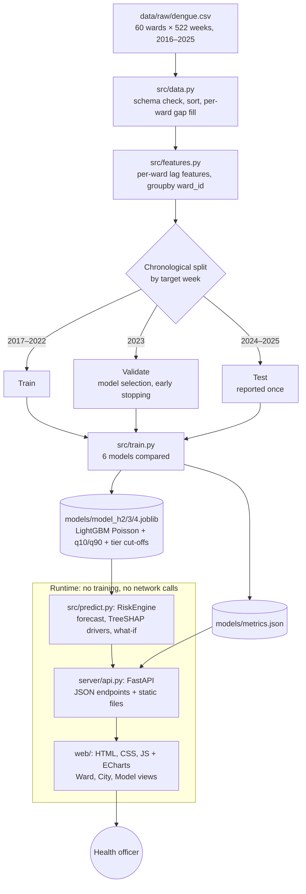

# Architecture: Dengue Watch

Ward-level dengue early warning for Dhaka North, Dhaka South, Chattogram, Gazipur and Narayanganj
(60 wards). The system predicts weekly cases **2, 3 and 4 weeks ahead** from lagged weather and
ward vulnerability, and turns each prediction into a **Low / Medium / High / Critical** risk tier.

## 1. System data flow

- **Offline (once):** `python -m src.train` builds the features, compares the models, trains the
  deployed models and writes the `.joblib` and `metrics.json` files. This takes about 3 minutes on
  a laptop CPU.
- **Online (every request):** `python -m server` loads the saved models once. The browser calls the
  JSON API: `/api/meta`, `/api/ward`, `/api/city`, `/api/heatmap`, `/api/model` and `/api/health`.
- An alternative Streamlit UI (`app/`) uses the same `RiskEngine`.

## 2. Forecast framing and lag features

At **issue week *t*** an officer knows the weather up to *t*. We predict `dengue_cases` at
**week *t + h***, with one direct model per horizon *h* ∈ {2, 3, 4}. Every feature uses only rows
≤ *t*, computed with `groupby("ward_id").shift(k)`, so data never leaks between wards or from the
future. `tests/test_features.py` verifies exact lag values, the absence of cross-ward leakage, and
that the label really is *t + h*.

| Group | Features (40 in total) | Why |
|---|---|---|
| Rain lags | rain 0–8 weeks before *t* | Breeding clock: eggs need 7–14 days to become adults, then incubation |
| Rain windows | 2-, 4- and 8-week sums, heavy-rain-week count | Accumulated standing water |
| Temperature and humidity | lags 0–4 weeks, 4- and 8-week means, diurnal range | Mosquito development and survival |
| Ward vulnerability | density, water-logging, sanitation | Same rain, different outcome per ward |
| Interactions | rain × water-logging, rain × (1 − sanitation) | Hyper-local hotspots |
| Season | sin/cos of the target week | Monsoon calendar |

**Evidence from the data:**
- Cases correlate most strongly with rainfall at a **3-week lag (r = 0.75)**, with humidity at
  2 weeks and with temperature at about 8 weeks.
- Water-logging risk correlates 0.82 with a ward's average cases.
- At *h* = 3 the top feature is `rain_sum_2w`, which is rain 3–4 weeks before the target week.

## 3. Chronological validation split

| Set | Target weeks | Used for |
|---|---|---|
| Train | 2017–2022 (2016 is used only as lag history) | Fitting |
| Validation | 2023 | Model comparison, early stopping |
| Test | 2024–2025 | Final evaluation, looked at once |

Rows are **never shuffled**. An expanding-window **backtest** also retrains on all years before *Y*
and predicts *Y* for every *Y* from 2019 to 2025; the yearly error stays between 0.9 and 1.7 cases.
**Risk-tier cut-offs** come from training data only (the 60th, 80th and 95th percentiles of weekly
cases): **Low < 1 ≤ Medium < 5 ≤ High < 13 ≤ Critical**.

## 4. Model selection rationale

On the validation season (2023), 3 weeks ahead:

| Model | MAE | RMSE | High-risk recall |
|---|---|---|---|
| Baseline: copy this week | 2.69 | 5.25 | 0.69 |
| Baseline: same week last year | 2.12 | 4.20 | 0.85 |
| Poisson regression (statistical) | 1.39 | 2.93 | 0.85 |
| Random forest | 1.22 | 2.41 | 0.90 |
| XGBoost (Poisson) | 1.16 | 2.41 | 0.89 |
| **LightGBM (Poisson), deployed** | **1.15** | **2.37** | **0.90** |

**Why LightGBM with a Poisson objective:**
- The target is a non-negative count and 58% of weeks are zero, which Poisson loss handles naturally.
- It captures non-linear rain × vulnerability effects.
- It is the best or tied-best model on validation.
- It is fast to train.
- It gives exact TreeSHAP explanations for free (`pred_contrib=True`).

Separate quantile models (α = 0.1 and 0.9) give an 80% likely range. A deliberate simplification:
adding past case counts changed test error by less than 0.01, so the deployed model uses **weather,
ward and season only**. It keeps working when hospital reports are delayed.

**Held-out test (2024–2025):**

| Horizon | MAE | RMSE | Exact tier accuracy | High-risk recall | 80% range coverage |
|---|---|---|---|---|---|
| 2 weeks | 0.995 | 1.99 | 79.8% | 87% | 77% |
| 3 weeks | 1.019 | 2.01 | 78.9% | 84% | 73% |
| 4 weeks | 1.161 | 2.28 | 77.2% | 86% | 72% |

At 3 weeks, this is 1.7× more accurate than "same week last year".

**As a yes/no outbreak alert (≥ 4 cases in a ward-week).** The same model gives the alert by scoring
P(cases ≥ 4) from its Poisson forecast and flagging a ward-week when that is ≥ 0.5. No separate
classifier is needed. Results on the 2024–2025 test, all 60 wards:

| Horizon | Accuracy | Recall (outbreaks caught) | Precision | F1 | ROC-AUC |
|---|---|---|---|---|---|
| 2 weeks | 93.3% | 94.8% | 81.0% | 0.874 | 0.979 |
| 4 weeks | 93.2% | 93.8% | 81.1% | 0.870 | 0.974 |

**What did not help** (`python -m src.experiments`, test error at *h* = 3; the deployed model is 1.019):

| Alternative | Test MAE |
|---|---|
| Optuna tuning | 1.019 |
| LightGBM + XGBoost ensemble | 1.019 |
| All-model ensemble | 1.052 |
| MLP neural net | 1.166 |
| One model per city | 1.033 |
| One model per ward | 1.093 |
| Season / off-season models | 1.012 |
| 24 extra features (longer lags, smoothed weather, city-wide weather) | 1.030 |

Every gain is within about 0.01, which is noise. The all-model ensemble looked best on validation
but was worse on test, because it overfits a single season. If weekly counts are Poisson around the
true mean, even a **perfect model would average about 0.81 cases off**, so we are close to the
achievable limit. One global model also forecasts new wards without retraining.

## 5. Compute and cost efficiency

- **Train once, serve many.** The models are serialised with `joblib` (about 1.5 MB per horizon).
  The server never retrains.
- **Caching.**
  - The `RiskEngine` and all forecast tables (60 wards × every week × 3 horizons) are built once
    at startup.
  - API responses are computed from in-memory tables.
  - The browser keeps a small response cache.
- **Latency.**
  - Cold start: about 1.5 s.
  - Warm API calls: 1–3 ms.
  - A new what-if scenario rebuilds features for **one ward only**: about 20 ms.
- **Request minimisation in the UI.** Slider changes are debounced (about 150 ms), stale requests
  are cancelled with `AbortController`, and the ECharts library is stored locally (no CDN calls).
- **LLM and API cost: zero.** No LLM, no external weather API and no paid service at runtime, so
  there are no tokens to budget and no rate limits. Statistical and ML models only, so the system
  cannot hallucinate numbers.
- **Light install.** The runtime needs 7 packages. A fresh `pip install -r requirements.txt` takes
  under a minute with a warm cache.

## 6. Resilience

- **Input checking.** On load, the system validates the schema and rejects duplicate ward-weeks. It
  fills missing weather **within a ward only**.
- **API errors.** Bad parameters (an unknown ward, an invalid date) return a clear 400 message.
  Dates are clamped to the valid range, and no stack trace ever reaches the UI.
- **Frontend.** If a request fails, the frontend shows an inline message with a **Retry** button.
  Future weeks show "not yet recorded" instead of failing.
- **Safe outputs.** Predictions are clipped to zero or above, and the likely range always contains
  the point forecast.
- **Planned live weather feed (final round).** Fetch once per day per city, cache to disk with a
  timestamp, retry with exponential back-off, and fall back to the last cached value, so the
  dashboard never breaks when the network does.

## 7. Phase 2: operational command system

Phase 2 adds operations modules on top of the unchanged forecaster. The onsite dataset
(`data/raw/dengue_onsite.csv`) has the same 31,320 rows and identical base columns as the Phase 1
file, plus `saline_bags_needed`, `diagnostic_kits_needed` and `hospital_beds_required`.
`tests/test_data.py` checks that the base columns are identical. So the features, models and
forecasts do not change, and no retraining is needed. `config.RAW_CSV` uses the onsite file when it
exists and falls back to `dengue.csv`.

### 7.1 Constrained resource allocation (`src/resources.py`, `GET /api/allocation`)

**Supply rates are learned, not hardcoded.** In the data, each supply is almost exactly a per-case
ratio. One rate `k` per supply is fitted by least squares through the origin
(`units = k × cases`) on **training years only** (≤ 2022), then scored on 2024–25. The rates are
cached in `models/resource_rates.json`; refit them with `python -m src.resources`.

| Supply | k per case | R² (test) |
|---|---|---|
| Saline bags | 2.384 | 0.9996 |
| Diagnostic kits | 1.158 | 0.998 |
| Hospital beds | 0.295 | 0.973 |

**Units.** Requirement = `round(k × expected cases)` for the forecast week. A "safety" figure uses
the q90 forecast (upper end of the 80% range).

**Priority.** Wards are sorted by risk tier (Critical > High > Medium > Low). Within a tier they
are sorted by `expected_cases × density_weight`, where
`density_weight = ward density / city median density`, clipped to 0.5–2.0. Ties break by ward ID,
so the plan is deterministic. Each ward's priority rank is shown in the UI.

**Allocation, per supply.** Available stock = `floor(stock% × total required in scope)`, where the
scope is one city or all 60 wards. Stock is then handed out greedily:
1. Critical wards are filled completely, in priority order.
2. With the optional floor: every other ward is raised to 20% of its need.
3. The remaining stock goes down the priority list.

No ward gets more than it needs, and total allocated = min(available, required), so nothing is
wasted. Tests check this conservation property at several stock levels.

**Flags.**
- **CRITICAL DEFICIT:** a High or Critical ward gets less than 100% of any supply.
- **WARNING:** a lower-tier ward gets less than 100% of any supply.

**Spraying crews.**
- Crews needed: Low 0, Medium 1, High 2, Critical 3.
- Wards in the top 25% of density in their city get +1. This applies only to wards that need
  spraying at all, i.e. Medium and above.
- The "Total spraying crews" pool is assigned down the same priority list.

**Cost.** One request is a pandas lookup of the precomputed forecast table plus a greedy pass over
at most 60 wards. It takes about 30 ms cold, and results are cached per (scope, week, horizon,
stock, crews, floor).

